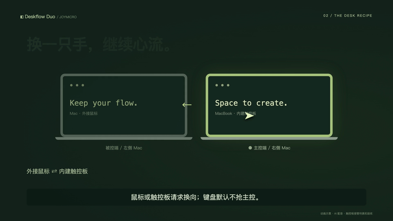
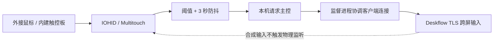

# ◧ Deskflow Duo

**两台 Mac，一张自在的桌面。换一只手，继续心流。**
**Two Macs. One calmer desk. Move a pointer to take control.**

[中文](#中文指南) · [English](#english-guide) · [交互展示](docs/index.html) · [AI Skill](skills/deskflow-duo/SKILL.md)



> v0.1 developer preview. 双机左右布局；默认只有鼠标/触控板抢控，键盘不抢控。原始环境已确认外接鼠标切换和内建键盘旧规则切换；内建触控板物理触摸读取已确认，**触摸触发接管的完整链路尚未完成正向真机验收**。本仓库的通用安装包仅完成隔离测试，不能视为干净双机实测通过。动画为示意，不是实机录屏。

## 中文指南

Deskflow 负责跨屏键鼠传输，Duo 检测正在使用的物理指针，并协调两个 Deskflow 实例的方向。适合左侧 Mac 接外接键鼠、右侧 MacBook 使用内建触控板并连接显示器的桌面；左右顺序可对调。



两端 server 常驻待命；client 按角色启停。网络不是严格的分布式互斥锁，重连或同时接管可能短暂双向连接，优先节点负责打破平局。连接观察每 0.5 秒执行一次 `lsof`；失去对端客户端超过约 5 秒后回退为 follower。原始双机环境切换链路测得约 0.36–0.78 秒，不能保证其他网络上的端到端延迟。

### 安装

需要 macOS、Python 3、Xcode Command Line Tools、Deskflow **1.27.0**。目前 Swift 为本机架构构建，不提供公证二进制。先从 [Deskflow 官方发行页](https://github.com/deskflow/deskflow/releases/tag/v1.27.0) 安装匹配架构的 App 到 `/Applications/Deskflow.app`，核对发行资产校验值与 Apple 签名。已有配置请先备份，退出其他 Deskflow GUI/实例以免冲突；不要直接替换正在使用的配置。

在两台 Mac 上分别执行：

```bash
# 首次缺少编译工具时先执行，系统安装窗口完成后继续
xcode-select --install
# Python 3 可从 python.org 安装

git clone https://github.com/joymicro4/deskflow-duo.git
cd deskflow-duo
cp config/example.json config/local.json
# 编辑 local.json：两台机器共享同一份 nodes/layout/preferred
./scripts/install.sh config/local.json mac-left
# 另一台的最后一个参数改成 mac-right
```

这是单命令本地安装入口；依赖下载、双机指纹核验和系统权限需人工完成。脚本不要求 sudo、不自动下载执行未知程序、不自动改防火墙，也不访问另一台机器。先预览：

```bash
python3 scripts/duo.py install --config config/local.json --node mac-left --dry-run
```

默认数据目录为 `~/Library/Application Support/DeskflowDuo`，四个 LaunchAgent 的前缀为 `ai.joymicro.deskflow-duo.`。安装会构建并复制 App、脚本和配置，生成本机 TLS 证书；**不会自动启动监听与网络服务**。重复安装前先 `stop`，现有文件会备份到状态目录的 `backups/`。

### TLS 互信与授权

1. 每台执行 `python3 scripts/duo.py fingerprint`，通过可信渠道核对另一台的 SHA-256。指纹可分享，PEM 内含私钥，不可分享。
2. 每台执行 `python3 scripts/duo.py trust 对方的SHA256`。可含冒号；工具会写入本实例的 `tls/trusted-servers` 与 `tls/trusted-clients`，内容格式为 `v2:sha256:<小写无冒号摘要>`。不会关闭 TLS 校验。
3. 执行 `python3 scripts/duo.py permissions`。在系统设置 → 隐私与安全性，给 **Deskflow** 开启辅助功能与输入监控；给状态目录 `Duo Auto Switch.app`（Duo Auto Switch）开启输入监控。需要时在系统文件选择器按 ⌘⇧G 输入该目录。权限必须由用户自己点击。
4. 执行 `python3 scripts/duo.py start`。首次请求授权可能在启动后出现，授权后 `stop` 再 `start`。执行 `doctor`，检查日志中 `WATCH`、`input-monitoring=granted` 与双方安全连接成功记录。

源码自编译默认使用 ad-hoc 签名，指定的 designated requirement 只检查 bundle identifier。**任何使用同一 identifier 的程序都可能继承这条授权**；它是个人本机构建的权衡，不能当作强身份保证。正式分发应使用 Developer ID、绑定证书的签名要求及 Apple 公证，升级后重新验证权限。不要使用其他公司的证书。

### 配置

`config/example.json` 使用 RFC 5737 文档地址，必须替换。地址建议 DHCP 保留或可稳定解析的主机名。两端的节点名称、端口和布局必须一致；本机节点通过 `--node` 指定。

| 配置 | 用途 |
|---|---|
| `nodes` | **恰好两台**。更多机器会被拒绝，尚未实现多机仲裁 |
| `name` / `host` / `port` | Deskflow 屏幕名、地址、各自 server 监听端口；两机可用相同端口 |
| `input` | `external` 接受 USB/蓝牙物理设备；`builtin` 接受内建设备和内建触控板 |
| `layout` | 从左到右的两个名称；交换数组顺序可反转布局 |
| `preferred` | 同时连接时优先主控的节点 |
| `pointerReports` | 0.5 秒窗口内非零 HID 报告数，默认 6 |
| `touchFrames` | 0.5 秒内带接触的内建触控帧数，默认 25 |
| `keyDowns` | 1.5 秒内按键数，默认 **0 = 不抢控**；设为 2 可恢复旧行为，但可能打断输入 |
| `deviceProduct` | HID 产品名包含匹配；空串接受符合 input 规则的设备。触控板走独立路径，不受该过滤器限制 |

配置从 JSON 解析，不作为 shell 执行。改变配置后 `stop`、重新安装、再 `start`；只变参数无需重新编译。`server.conf` 只写 links，Deskflow 1.27 的屏幕列表在 `Deskflow.conf` 的 `[computer_名称]` 中。

### 日常使用与恢复

```bash
python3 scripts/duo.py doctor       # 只读检查，警告时 exit 1
python3 scripts/duo.py claim        # 手动接管，不受输入阈值限制
python3 scripts/duo.py stop
python3 scripts/duo.py start
python3 scripts/duo.py uninstall   # 停止并备份、移除本项目 LaunchAgent
```

也可在 Finder 打开状态目录中的 `Duo Take Control.app` 手动接管，可放入 Dock。

卸载保留配置、证书、日志与备份，不删除 Deskflow，不修改其他工具。恢复时重新安装并核对指纹。`DUO_STATE_DIR`、`DUO_LAUNCH_DIR` 可用于隔离测试；真实运行须两者路径固定。

**键盘路由限制：** server 的物理键盘跟随光标转发，client 的本地物理键盘始终输入本机。若光标在主控端却敲被控端键盘，字会进被控端自己的前台 App。先移动要使用的指针、跨屏定位，再输入。它不是显示器信号切换器，也不传输视频。

### 排障 / FAQ

| 现象 | 检查与处理 |
|---|---|
| 没有自动切换 | `doctor`、输入监控授权、`logs/auto.log` 的 `WATCH`；默认键盘不触发 |
| HID `0xe00002c5` | 设备可能被 Karabiner 等独占。让用户自行决定停用，绝不自动卸载 |
| 触控板没有普通 HID 事件 | Apple Silicon 走私有 MultitouchSupport；日志应有 `WATCH: builtin trackpad`；符号不可用时用手动 `claim` |
| 手掌轻放也切换 | 当前按接触帧计数，不区分滑动与静止接触；提高阈值或改用手动 |
| 睡醒后触控无效 | 私有 API 的唤醒恢复尚未验证；stop/start 并复测，不保证系统升级兼容 |
| 指纹校验失败 | 两端重新核对 `fingerprint`，不要禁用校验；检查证书是否更新、过期 |
| 连不上 | 检查 host 解析、Wi-Fi 客户端隔离、系统防火墙与选定 TCP 端口；不要自动对公网开放 |
| 跨屏边缘不对 | 系统设置 → 显示器，对齐本机内建屏与外接屏的可用边缘；仅共享真实相接边缘 |
| 切换来回跳 | 检查其他 Deskflow 实例、双方 preferred 是否一致，观察 3 秒防抖及约 5 秒收敛 |
| 改完参数没变化 | 安装使用状态目录中的副本，编辑仓库后须 stop、重新 install、start |

`doctor` 检查本机配置、依赖、信任文件和监听日志，不读取或修改 TCC 数据库，不能替代真实跨机输入测试。日志留在本机；公开 issue 前脱敏。当前日志未自动轮转，请定期在 stop 后归档。

### 与其他方案比较

| 方案 | 适用场景 | 代价 / 边界 |
|---|---|---|
| macOS 通用控制 | 满足 Apple 设备与账户条件，优先尝试系统方案 | 具体系统、账户与网络要求见 [Apple 官方说明](https://support.apple.com/102459) |
| Deskflow | 跨设备的软件键鼠共享，手动选择服务角色 | Duo 是独立附加层；Deskflow 的平台支持不等于 Duo 已跨平台验证 |
| Barrier | 既有 Barrier 工作流 | [Barrier 项目](https://github.com/debauchee/barrier) 与 Deskflow 配置/版本不同，本工具不直接支持 |
| Deskflow Duo | 希望按物理鼠标/触控板自动换向的双 Mac 桌面 | 私有触控 API、权限与客户端键盘路由限制；多机未实现 |

### AI Skill

把整个仓库放在固定位置，把 `skills/deskflow-duo` 链接到 `~/.claude/skills/deskflow-duo` 或 `~/.codex/skills/deskflow-duo`。告诉 Agent 仓库位置并请求配置双 Mac；Skill 会先盘点、生成 dry-run，再指导人工授权与逐项验收，不擅自覆盖运行配置。

## English guide

Deskflow Duo adds physical-pointer takeover to a two-Mac Deskflow setup. Move the external mouse on one Mac or use the built-in trackpad on the other to request control. **Keyboard takeover is disabled by default.** This is a developer preview: physical touch capture is confirmed in the original environment, but touch-triggered takeover still needs a positive hardware acceptance test. The generalized installer has only been tested in isolation.

1. Install Python 3, Xcode Command Line Tools and the official Deskflow **1.27.0** app. Back up existing settings and stop conflicting instances yourself.
2. Clone this repository on both Macs. Copy `config/example.json` to `config/local.json`; replace documentation addresses, names, ports and left-to-right layout. Use the same topology on both machines.
3. Run `./scripts/install.sh config/local.json mac-left` on the left Mac, and use `mac-right` on the other. Preview first with `python3 scripts/duo.py install --config config/local.json --node mac-left --dry-run`.
4. Run `python3 scripts/duo.py fingerprint` on each. Independently verify the peer's SHA-256 and run `python3 scripts/duo.py trust PEER_SHA256` on both. Never copy private PEM keys or disable verification.
5. Run `python3 scripts/duo.py permissions`. Manually grant Deskflow Accessibility and Input Monitoring, and Duo Auto Switch Input Monitoring. Run `start`; restart after permissions change, then run `doctor`.
6. Test external-pointer takeover, cross-screen typing, built-in-trackpad takeover while that Mac is a follower, simultaneous use, sleep/wake and manual `claim` before relying on it.

Configuration: exactly two nodes, configurable horizontal order, host/port, preferred tie-break node, `input` (`builtin`/`external`), HID `deviceProduct` substring, `pointerReports` (6), `touchFrames` (25), `keyDowns` (0). Three or more nodes are rejected. Nonzero `keyDowns` enables the older keyboard takeover behavior, which can interrupt typing. JSON is never shell-sourced. Reinstall after changes; stop first. State and backups live in `~/Library/Application Support/DeskflowDuo`.

Architecture: IOHID physical events and private MultitouchSupport contact frames → thresholds → 3-second debounce → local role change → Deskflow TLS client coordination. Servers remain ready; clients follow the current role. Polling and a preferred-node tie-break converge after conflicts; this is not strict distributed mutual exclusion. Original switching-link measurements were 0.36–0.78 seconds, not a latency guarantee.

Troubleshooting: missing `WATCH` / permission logs means check Input Monitoring and filters. `0xe00002c5` may indicate a seized device (for example Karabiner); do not automatically uninstall other tools. Private MultitouchSupport may break after OS updates or sleep; stationary contact can trigger takeover. Use `claim` as fallback. Align physical display edges in macOS settings. Check peer trust, host resolution, firewall and TCP ports for connection failures. `doctor` is read-only and cannot prove TCC grants or end-to-end hardware behavior.

Keyboard routing: a server keyboard follows the cursor; a client's physical keyboard always types locally. Move the desired pointer and position the cursor before typing. This does not switch video signals. Prefer Apple's Universal Control if its device/account requirements fit. Barrier is a separate project and is not directly supported. See the linked official sources above.

Local builds use ad-hoc signing with an identifier-only designated requirement: another executable with the same identifier may inherit permissions. Formal distribution needs certificate-bound Developer ID signing and notarization. No bypass of macOS permission dialogs is provided. `stop` stops only Duo jobs; `uninstall` backs up/removes its LaunchAgents and keeps state/keys for recovery. Logs are local and currently require manual archival.

## Development / License

```bash
python3 -m unittest discover -s tests
bash -n scripts/*.sh
./scripts/build.sh
cd video && npm ci && npm run lint
npm run dev -- --port=4190
npx remotion render src/index.ts DeskflowDuo out/deskflow-duo.mp4
```

MIT for Duo source, documentation and illustrations; Deskflow retains its own [GPL-2.0 license](https://github.com/deskflow/deskflow/blob/v1.27.0/LICENSE). It is not vendored here. Remotion has separate [licensing terms](https://www.remotion.dev/license). Narration is AI-generated with Doubao's Taiwan-accent Xiaohe voice; credentials are never included. See [video production notes](video/README.md).
