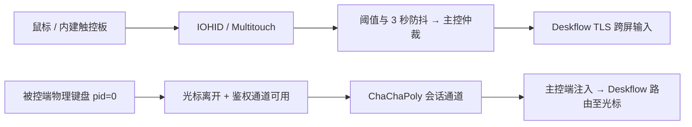

# ◧ Deskflow Duo

**Mac mini 在桌上，MacBook 在手边。两套键鼠，控制两台 Mac，不需要相同 Apple ID。**

**Mac mini + MacBook. Either keyboard, either pointer. No shared Apple Account required.**

[官网](https://joymicro.ai/deskflow-duo) · [GitHub Pages](https://joymicro4.github.io/deskflow-duo/) · [English](#english) · [AI Skill](skills/deskflow-duo/SKILL.md) · [更新记录](CHANGELOG.md)


新 Mac mini 插着键盘鼠标，旁边再放一台 MacBook，两台混着用。外接键鼠能控制两台，MacBook 自带的键盘和触控板也能控制 Mac mini。**四种组合，光标在哪，键盘就输入到哪。** 鼠标/触控板决定谁当主控，键盘不抢控（`keys=0`）。

v0.2 预览版。用户已在原始双机环境确认四种组合可用；本仓库的参数化安装、协议加固与恢复逻辑经隔离测试，仍须在自己的两台 Mac 上完成验收。动画是示意，不是实机录屏。

## 首次安装：5 步

**装 Deskflow 与编译依赖 → 两台各跑 install → 互信 TLS 并安全配对共享密钥 → 两台各开启输入监控和辅助功能 → start + doctor + 四组合验收。**

### 1. 安装依赖，下载源码

需要 macOS、Python 3、Xcode Command Line Tools、Deskflow **1.27.0**。先备份已有 Deskflow 配置并自行停止冲突实例，不要覆盖正在运行的桌面方案。

- 从 [Deskflow 官方发行页](https://github.com/deskflow/deskflow/releases/tag/v1.27.0) 安装匹配架构的 App 到 `/Applications/Deskflow.app`，核验校验值与签名。若通过 Homebrew 安装，确认结果是 1.27.0；其他版本的日志/配置格式尚未适配。
- 首次缺少工具时执行 `xcode-select --install`，完成系统安装窗口。Python 3 可从 python.org 安装。

```bash
git clone https://github.com/joymicro4/deskflow-duo.git
cd deskflow-duo
cp config/example.json config/local.json
```

### 2. 编辑桌面配置，在两台分别安装

把文档示例地址替换为自己的稳定地址，保持两端 `nodes/layout/preferred/keyboardForwarding` 一致。建议 DHCP 保留或稳定的主机名。默认是左侧 `mini`，右侧 `macbook`；Air + Pro 另见 `config/air-pro.json`。

```bash
# 先只预览
python3 scripts/duo.py install --config config/local.json --node mini --dry-run
# Mac mini
./scripts/install.sh config/local.json mini
# MacBook 上执行同一入口，末尾改成 macbook
```

安装会本地编译 App、生成 TLS 证书、四个 LaunchAgent 和手动接管 App，**不会自动启动**。状态目录为 `~/Library/Application Support/DeskflowDuo`；配置覆盖前自动备份。重装前 `stop`，紧急关闭状态不会被重装清除。

### 3. 配对：TLS 指纹 + 共享键盘密钥

两台分别执行 `python3 scripts/duo.py fingerprint`，通过可信渠道核对对方 SHA-256，然后各自执行：

```bash
python3 scripts/duo.py trust PEER_CERT_SHA256
```

这只传证书指纹，不传私钥。Deskflow TLS 校验保持开启。键盘转发还需要两端拥有同一个 **32 字节随机二进制密钥**：

```bash
# 只在一端生成；已存在时拒绝覆盖
python3 scripts/duo.py keygen
python3 scripts/duo.py key-fingerprint
```

推荐在两台都完成 install 后，通过**已经核验过主机身份、可登录的 SSH** 直接配对：

```bash
# 替换为自己的 SSH 别名/目标；不自动接受未知主机指纹
python3 scripts/duo.py pair --ssh macbook.example
```

密钥只经 SSH 的标准输入传输，不放入命令行、剪贴板或临时文件；对端已有密钥时拒绝覆盖。这个便捷入口面向默认状态目录。

也可通过已经核验主机身份的 SSH/SCP 或其他可信加密文件通道，把状态目录中的 `fwd.key` 安全送到另一台的临时私密文件（权限 0600）。不要把密钥打印、复制到聊天或剪贴板、写进仓库或截图。另一台导入后比较两边公开的密钥指纹：

```bash
python3 scripts/duo.py key-import /path/to/private/transferred-key
python3 scripts/duo.py key-fingerprint
```

确认一致后移除临时副本。默认 Mac mini 监听独立 TCP 端口 `24910`，MacBook 连接它；用户需按各自防火墙策略允许该 App/端口，**不需要关闭防火墙或改 DNS**。不要在公网暴露监听端口。两端必须使用相同版本，v0.2 的会话协议不兼容早期运行原型。

### 4. 两台各开启系统授权

```bash
python3 scripts/duo.py permissions
```

在系统设置 → 隐私与安全性，给 **Deskflow** 与 **Duo Auto Switch** 都开启「输入监控」和「辅助功能」。Duo App 位于状态目录的 `Duo Auto Switch.app`，文件选择器可用 ⌘⇧G 输入路径。首次启动后可能再次显示授权请求；授权后 stop/start 重启。

必须由用户自己点击，不修改 TCC 数据库。默认本地 ad-hoc 签名的 designated requirement **只认 bundle identifier**，可减少重新编译后的重复授权，但同 ID 的其他程序也可能继承权限。正式发行应使用绑定证书的 Developer ID 签名和公证；本项目尚未公证。

### 5. 启动、自检与四组合验收

```bash
python3 scripts/duo.py start
python3 scripts/duo.py doctor
```

| 指针主控端 | 光标位置 | 外接键盘输入到 | MacBook 键盘输入到 |
|---|---|---|---|
| Mac mini | Mac mini | Mac mini | Mac mini |
| Mac mini | MacBook | MacBook | MacBook |
| MacBook | Mac mini | Mac mini | Mac mini |
| MacBook | MacBook | MacBook | MacBook |

用鼠标/触控板切换两次，分别打字、测试 ⌘ 快捷键及修饰键释放，再验断线回退、睡眠唤醒和紧急开关。用户已确认参考环境四组合可用；`doctor` 只读本机配置和日志，不能代替你的真机验收。

## 日常使用与紧急恢复

- **⌃⌥⌘K**（Control + Option + Command + K）切换键盘跟随，并弹通知。只认物理按键，状态写入 `kbfwd-disabled`，重启/重装仍保留。再按一次恢复。禁用后，被控端键盘只输入本机。
- `python3 scripts/duo.py claim` 或打开状态目录 `Duo Take Control.app` 手动接管，可将 App 放入 Dock。
- `stop` 停止本项目服务；`start` 恢复；`uninstall` 备份/移除本项目 LaunchAgent，保留状态、证书、共享密钥与备份，不删除 Deskflow 或其他工具。
- 共享密钥轮换需先停两端、私下备份旧 key，显式替换两端后重启。工具拒绝静默覆盖密钥。

## 原理



主控端的键盘由 Deskflow 跟随光标。被控端只在光标不在本机、收到过有效鉴权心跳且对端可注入时，拦截物理按键，经加密通道送回主控端。远端合成事件不再拦截。通道不通、权限不够或紧急关闭时，本地放行；断开和超时清理注入的普通键与修饰键。已经排入网络的最后少量按键仍可能在链路突断时丢失，恢复后需重新输入。

通道使用 CryptoKit ChaChaPoly、32 字节预共享密钥、每连接双方随机 nonce、单调序号和 10 秒时间窗；同连接与跨连接重放均有测试。没有前向保密，也不宣称经过独立安全审计。只在可信网络使用，不能与旧原型混连。日志记录计数，不记录按键内容。

Deskflow 两端 server 待命，client 按角色启停。监督进程每 0.5 秒观察自己管理的进程连接，优先节点打破平局；本机状态更新用进程锁和原子时间戳，避免接管/降级竞态。网络收敛不是严格的分布式互斥。参考切换链路约 0.36–0.78 秒，不保证其他网络的端到端性能。

## 配置

| 字段 | 用途 |
|---|---|
| `nodes` | 恰好两台；`name/host/port/input` 为屏幕名、地址、Deskflow 端口与 builtin/external 设备来源 |
| `layout` / `preferred` | 左右顺序 / 平局优先主控节点 |
| `pointerReports` / `touchFrames` | 0.5 秒内的物理指针报告/触摸帧阈值，默认 6 / 25 |
| `keyDowns` | 默认 0，键盘不抢控；不建议改为旧键盘抢控行为 |
| `deviceProduct` | HID 产品名包含过滤；空串接受符合 input 的物理设备，不过滤独立的 Multitouch 路径 |
| `keyboardForwarding.mode` | on / observe / off；observe 不拦截、不注入，仅诊断 |
| `keyboardForwarding.listener` / `port` | 监听节点 / 独立 TCP 端口，不能与 Deskflow 端口冲突 |

JSON 不作为 shell 执行。更多机器、上下排列与任意拓扑尚未实现；Mac 内部多显示器需在系统设置中对齐可跨屏的边缘。更改配置后 stop → install → start，无需为参数变化重新编译。

## 与 macOS 通用控制比较

| 项目 | Deskflow Duo | macOS 通用控制 |
|---|---|---|
| 同一个 Apple ID / Apple Account | **不需要**，依靠网络与密钥配对 | 需要相同 Apple Account，并开启双重认证 |
| 同事 / 公司机器 | 可使用不同账号，仍需设备权限和组织策略允许 | 不同账号的机器不满足原生账户要求；仍受组织策略约束 |
| 键盘跟随光标 | 两套键盘均可；需启用 v0.2 转发 | 支持连接设备间的键盘、鼠标、触控板操作 |
| 开源 | Duo MIT；Deskflow GPL-2.0 | Apple 系统内建功能，未作为开源项目提供 |
| 覆盖范围 | 当前两台 Mac，需安装与权限 | 官方支持的 Mac / iPad，满足系统和距离要求 |

账户与设备要求依据 [Apple 官方说明](https://support.apple.com/102459)。Deskflow 自身是 [开源软件 KVM](https://github.com/deskflow/deskflow)，Duo 是独立的 macOS 附加层；Barrier 的配置与版本不同，本工具不直接支持 Barrier。

## 排障 / 已知边界

| 现象 | 处理 |
|---|---|
| 键盘没跟随 | 两端同版本、`key-fingerprint` 一致、0600、独立端口可达、两端双权限、日志有鉴权 pong 与 tap ok |
| 输入回到本机 | 通道或对端权限不可用时按设计本地放行；检查 doctor，不要关闭安全校验 |
| 安全输入 / 密码框 | macOS 可能阻止 event tap，按键留在本机；不要绕过系统保护 |
| 输入法/布局不同 | 远端转发使用主控端的输入法和键盘布局 |
| ⌘ 卡住 / 链路异常 | ⌃⌥⌘K 紧急关闭；本版断线/超时会释放注入状态，重启并复测 |
| HID `0xe00002c5` | 设备可能被 Karabiner 独占；不自动卸载已有工具 |
| 触控板 | 使用私有 MultitouchSupport，系统更新可能失效；静止手掌接触也计入帧；手动 claim 兜底 |
| 睡眠唤醒 | 唤醒时进程退出、由 launchd 重建监听与通道；仍需逐系统版本复测 |
| 日志判断不准 | 依赖 Deskflow 1.27 entering/leaving 等日志文案；其他版本未适配 |
| 证书 / 连接失败 | 检查 TLS 指纹、证书期限、主机解析、Wi-Fi 隔离及防火墙；不自动修改 DNS/防火墙 |

日志尚无自动轮转，定期 stop 后归档。公开 issue 前脱敏。仅在你有权操作的设备上安装；不记录或上传打字内容，不需要 Apple ID 或云账户凭据。

## AI Skill

将仓库放在固定目录，把 `skills/deskflow-duo` 链接到 `~/.claude/skills/deskflow-duo` 或 `~/.codex/skills/deskflow-duo`。告诉 Agent 仓库位置，请它生成 dry-run、配置两台 Mac 并引导权限及配对；它不能代替你点击授权，也不能把密钥发进聊天。

## English

A Mac mini with an external keyboard/mouse sits next to a MacBook. Either pointer controls both Macs; either keyboard types wherever the cursor is. **No shared Apple Account is required.** Pointer activity selects the controller; keyboards never claim control by default.

Install in five stages: official Deskflow 1.27.0 + Python 3 + Command Line Tools → install on each node → verify TLS fingerprints and securely share the 32-byte forwarding key → manually grant both apps Input Monitoring and Accessibility on both Macs → start, doctor and test all four controller/cursor combinations.

Copy `config/example.json`, replace documentation addresses, and run `./scripts/install.sh config/local.json mini` on the mini and `... macbook` on the MacBook. Use `fingerprint` / `trust PEER_CERT_SHA256` for TLS. Run `keygen` on one side, then `pair --ssh macbook.example` over pre-established SSH with a verified host key. This sends the key only through encrypted stdin and compares public fingerprints; it refuses to overwrite an existing peer key. Alternatively use authenticated file transfer plus `key-import PRIVATE_FILE`. Never print, paste or commit keys. The listener and independent port are configurable. Both ends must run the same version.

The follower forwards only physical (`pid=0`) key events while its cursor has left, an authenticated peer can inject, and forwarding is enabled. ChaChaPoly frames bind both session nonces, sequence and timestamp; release/timeout/disconnect clears injected keys and modifiers. Control-Option-Command-K toggles forwarding with a notification and persists across reinstalls. Broken channels fail open to local typing; a few in-flight events can be lost during abrupt failure. Secure Input can prevent capture, and the controller's input method/layout applies.

The reference two-Mac setup was confirmed by the user for all four combinations. This generalized build adds protocol/recovery hardening tested in isolation and still requires acceptance on your hardware. Private MultitouchSupport can change; stationary contact counts. This is a two-Mac preview, not multi-node arbitration. Local identifier-only ad-hoc signing can allow same-ID apps to inherit permissions; formal distribution requires certificate-bound signing and notarization. Logs need manual archival.

Apple Universal Control requires the same Apple Account with two-factor authentication; see the linked Apple documentation. Duo can pair different accounts on colleague/company Macs if permissions and organizational policies allow. No Apple credentials or cloud account are needed.

## Development / License

```bash
./scripts/build.sh
./scripts/test-protocol.sh
python3 -m unittest discover -s tests
bash -n scripts/*.sh
cd video && npm ci && npm run lint
npx remotion render src/index.ts DeskflowDuo out/deskflow-duo.mp4
```

Tests never load LaunchAgents or hook real keyboards. Use temporary `DUO_STATE_DIR` and `DUO_LAUNCH_DIR` for install tests. Duo source/docs/illustrations: MIT. Deskflow retains [GPL-2.0](https://github.com/deskflow/deskflow/blob/v1.27.0/LICENSE); Remotion has [separate terms](https://www.remotion.dev/license). The Remotion development toolchain currently reports 10 high transitive npm audit findings; the static website does not load that toolchain. AI narration uses Doubao's Taiwan-accent Xiaohe voice; credentials are not included.
